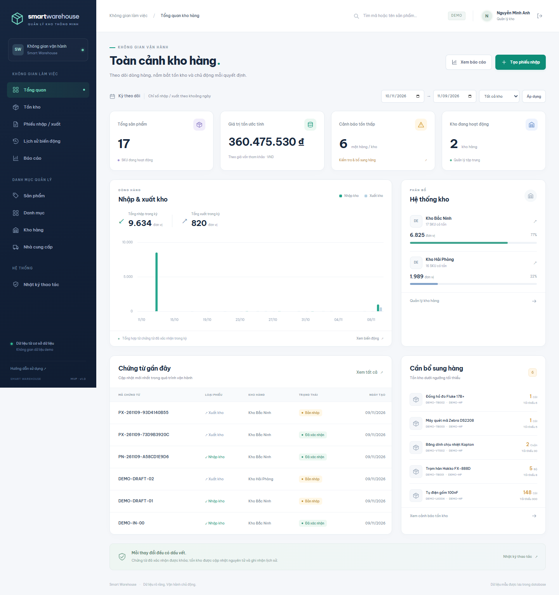

# Smart Warehouse

Ứng dụng quản lý kho nội bộ bằng Python 3.13, Django 5.2 LTS và PostgreSQL. Giao diện tiếng Việt gồm dashboard, danh mục, phiếu nhập/xuất nhiều dòng, tồn kho, lịch sử, báo cáo và quản lý tài khoản. Các con số được truy vấn từ database; dữ liệu trình diễn được đánh dấu **DEMO**.

## Điểm nổi bật

- **Nhập/xuất kho an toàn:** service layer, transaction và khóa dữ liệu PostgreSQL; chặn xuất vượt tồn và xác nhận trùng chứng từ.
- **Phân quyền tại backend:** Admin, Manager, Staff, Viewer; lưu nhật ký thao tác và khóa chứng từ đã xác nhận.
- **Dashboard và báo cáo thực:** Chart.js, lọc theo kỳ/kho/SKU, cảnh báo tồn thấp, xuất Excel/CSV và in phiếu.
- **Giao diện responsive:** Django Templates, Tailwind CSS và HTMX; hỗ trợ desktop, tablet, mobile; assets và font phục vụ local.
- **Kiểm chứng có bằng chứng:** 113 test trên PostgreSQL, 51 kiểm tra HTTP và bộ kiểm tra trình duyệt đã lưu; Docker Compose, migrations, dữ liệu demo và hướng dẫn backup/restore.



Xem [sơ đồ dữ liệu](docs/ERD.md), [quyết định thiết kế](DECISIONS.md) và [kết quả kiểm thử cùng giới hạn đã biết](IMPLEMENTATION_STATUS.md).

Phạm vi và tiến độ kiểm chứng nằm trong [SPEC.md](SPEC.md), [PLAN.md](PLAN.md) và [IMPLEMENTATION_STATUS.md](IMPLEMENTATION_STATUS.md). Tài liệu tiến độ ghi riêng lệnh đã chạy, kết quả và mục chưa xác minh. Chuyển kho, kiểm kê, barcode và lô hàng thuộc P2, chưa có trong MVP. Smart Sales, đơn hàng và thanh toán ngoài phạm vi dự án này.

## Mở bản đã cài trên máy này

Trên máy này, Windows Application Control hiện chặn thư viện native của `psycopg_binary`, nên ứng dụng Django native không khởi động lại được dù các kiểm thử trước đó đã chạy thành công. Launcher dùng **Docker local** để chạy ứng dụng và PostgreSQL; không thay đổi Windows policy. Cần Docker Desktop đã cài, file `.env` hiện hữu và Python trong `.venv` để chạy launcher. Từ PowerShell tại thư mục này, chạy:

```powershell
.\start.cmd
```

Hoặc nhấp đôi `start.cmd`; file gọi `.\.venv\Scripts\python.exe scripts/start.py --docker --open-browser`. Cờ `--open-browser` chỉ mở trình duyệt mặc định khi bạn chạy lệnh. Địa chỉ ứng dụng là **http://127.0.0.1:8010/**. Đăng nhập `demo_manager` hoặc một vai trò ở bảng bên dưới; mật khẩu nằm trong `DEMO_PASSWORD` của file `.env` local, không chia sẻ file này. Đổi mật khẩu bằng `docker compose exec app python manage.py changepassword demo_manager`.

Launcher kiểm tra Docker Engine, yêu cầu Docker Desktop khởi động nếu cần, build image, đợi database healthy, chạy migrations và khởi động app. `seed_demo --if-empty` chỉ tạo dữ liệu demo khi database trống và `DEMO_MODE=true`; không gieo thêm dữ liệu vào database đã sử dụng. Launcher không ghi đè `.env`, reset database hoặc xóa volume. Kết quả kiểm chứng launcher được ghi riêng trong [IMPLEMENTATION_STATUS.md](IMPLEMENTATION_STATUS.md).

Docker chạy nền. Dùng `docker compose stop` để dừng ứng dụng và database, giữ nguyên dữ liệu. Nếu cần cổng khác, chạy `.\.venv\Scripts\python.exe scripts/start.py --docker --port 8012`; thêm `--open-browser` khi muốn tự mở trình duyệt.

Database Docker dùng volume riêng của dự án Compose `smart-warehouse`; nó **không tự sao chép** dữ liệu PostgreSQL native tại **55433**. Các bản ghi QA và dữ liệu native trong `.runtime/pgdata` được giữ nguyên. Cổng 8000 và 55432 đang thuộc ứng dụng khác; không dừng hoặc dùng lại các cổng đó. Không chạy đồng thời native server và Docker trên cùng cổng ứng dụng.

## Chạy bằng Docker Compose

Cần Docker Desktop đang chạy, Docker Compose v2 và Python 3.13 để tạo `.env`. Thực hiện từ thư mục chứa `manage.py`:

```powershell
python scripts/init_env.py --prompt-demo-password
docker compose build
docker compose up -d --wait db
docker compose run --rm app python manage.py migrate
docker compose run --rm app python manage.py seed_demo --if-empty
docker compose up -d --wait app
docker compose exec app python manage.py check
```

Mở **http://127.0.0.1:8010/**. PostgreSQL chỉ nằm trong mạng nội bộ Compose, không publish cổng database ra máy host; ứng dụng bind vào `127.0.0.1:8010` (đổi bằng `APP_PORT` khi chạy Compose trực tiếp). Compose dùng named volume `warehouse_data` trong dự án `smart-warehouse`. `docker compose stop` dừng dịch vụ và giữ dữ liệu. Runbook trực tiếp chạy migrations như một bước rõ ràng; launcher cũng thực hiện bước đó trước khi khởi động app.

`init_env.py` tạo secret ngẫu nhiên và không in chúng. Nếu `.env` đã tồn tại, lệnh giữ nguyên file; không có tùy chọn ghi đè. Mật khẩu có thể chọn qua prompt ẩn hoặc được sinh ngẫu nhiên trong `.env`. Khi chuyển từ local PostgreSQL sang Compose, giữ `POSTGRES_*` và URL cùng thông tin đăng nhập; Compose tự thay hostname và port bên trong container bằng `DATABASE_HOST=db`, `DATABASE_PORT=5432`.

## Chạy native trên môi trường cho phép

Hướng dẫn này dành cho môi trường cho phép nạp thư viện Python native. Trên máy hiện tại, `psycopg_binary` đang bị Windows Application Control chặn; dùng Docker ở phần trên. Không tắt hoặc thay đổi policy để thực hiện hướng dẫn này. Launcher vẫn có chế độ `.\.venv\Scripts\python.exe scripts/start.py --native --port 8010` khi môi trường đáp ứng.

Cần [uv](https://docs.astral.sh/uv/getting-started/installation/) và PostgreSQL 17. `uv.lock` cố định dependency. Tạo database `warehouse` và role `warehouse` với mật khẩu riêng trùng `.env`; role local cần `LOGIN CREATEDB` để pytest có thể tạo database test. Dùng role riêng cho phát triển, không dùng database nghiệp vụ thật.

```powershell
uv sync --python 3.13
uv run python scripts/init_env.py --database-port 55433 --prompt-demo-password
# Khởi động PostgreSQL local tại port trong DATABASE_URL trước bước tiếp theo.
uv run python manage.py migrate
uv run python manage.py seed_demo
uv run python manage.py collectstatic --noinput
uv run python manage.py runserver 127.0.0.1:8010
```

Trên máy làm việc đã có runtime PostgreSQL portable trong `.runtime/pgsql`, chạy `uv run python scripts/local_postgres.py start` trước migrate; dùng `status` để kiểm tra và `stop` để dừng. Helper đọc `LOCAL_POSTGRES_PORT` trong `.env`; phiên Warehouse đã cấu hình **55433**, trùng port trong `DATABASE_URL`. Giữ cấu hình này, không chuyển sang cổng 55432 đang được dùng. Thư mục tiếng Việt trên Windows được ánh xạ tạm qua drive `W:`; có thể chọn `--drive X:` nếu `W:` đang dùng cho mục đích khác. Các binary, dữ liệu PostgreSQL và môi trường Python là trạng thái local được ignore, không phải source để commit. Máy sạch có thể dùng Compose hoặc cài PostgreSQL rồi tạo `.env` riêng.

Trên Windows, nếu `python` trỏ vào Windows Store alias, dùng Python đã cài hoặc `uv run python` trên môi trường cho phép. Nếu `uv` chưa có trên PATH nhưng đã cài cho tài khoản hiện tại, gọi `& "$env:USERPROFILE\.local\bin\uv.exe"` thay cho `uv`. Đổi cách gọi Python không giải quyết việc policy chặn thư viện `.pyd`.

## Đăng nhập và dữ liệu demo

Sau `seed_demo`, có bốn tài khoản:

| Tài khoản | Vai trò | Quyền chính |
| --- | --- | --- |
| `demo_admin` | Admin | Quản lý tài khoản, danh mục, chứng từ và báo cáo |
| `demo_manager` | Manager | Quản lý danh mục, duyệt chứng từ, xem audit và báo cáo |
| `demo_staff` | Staff | Tạo phiếu, sửa/hủy phiếu nháp của mình; xem dữ liệu |
| `demo_viewer` | Viewer | Chỉ xem và xuất báo cáo; mọi endpoint ghi bị chặn |

Mật khẩu của tài khoản mới lấy từ `DEMO_PASSWORD` trong môi trường hoặc `.env`, tối thiểu 12 ký tự. Không có mật khẩu mặc định trong source. Khi cần xem mật khẩu ngẫu nhiên, mở `.env` trên máy của bạn và không chia sẻ nội dung file. Chạy lại `seed_demo` không đổi mật khẩu hoặc nâng quyền tài khoản đã tồn tại và không nhân đôi bộ dữ liệu. Launcher dùng `--if-empty` để bỏ qua seed khi database đã có dữ liệu.

Bộ seed gồm 16 SKU, 4 danh mục, 2 kho, 3 nhà cung cấp, 27 chứng từ đã xác nhận và 2 phiếu nháp, với lịch sử 28 ngày. Mỗi số dư đều sinh từ dịch vụ xác nhận chứng từ. Không có dữ liệu khách hàng, số điện thoại hay thông tin thanh toán thật. Có thể tạo tài khoản quản trị riêng bằng `docker compose exec app python manage.py createsuperuser`; tài khoản superuser có quyền quản trị trong ứng dụng.

## Luồng trình diễn nghiệm thu

1. Đăng nhập Manager. Tạo một danh mục, SKU, kho và nhà cung cấp riêng để không trộn với dữ liệu DEMO.
2. Tạo phiếu nhập nháp với số lượng `1000`, chọn đơn giá tham khảo và lưu. Tồn chưa đổi khi chỉ lưu nháp. Xác nhận phiếu; tồn lên `1000`.
3. Tạo và xác nhận phiếu xuất `600`; tồn còn `400`, lịch sử có hai biến động tương ứng.
4. Tạo phiếu xuất `401` và thử xác nhận. Hệ thống giải thích thiếu tồn, phiếu vẫn nháp và tồn vẫn `400`.
5. Gửi lại yêu cầu xác nhận phiếu nhập/xuất đã xử lý. Trạng thái từ chối xác nhận lặp; không sinh thêm movement.
6. Xem dashboard và báo cáo theo kho/ngày/SKU; tải Excel/CSV và đối chiếu số liệu với chứng từ. In phiếu bằng chức năng in của trình duyệt.
7. Đăng nhập Staff để tạo phiếu nháp và xác nhận rằng không có quyền duyệt; thử Viewer gọi trực tiếp endpoint ghi phải nhận 403. Admin có thể quản lý vai trò trên màn hình Người dùng.

Mọi thao tác ghi quan trọng được ghi lại người thực hiện, thời điểm và nội dung thay đổi. Xem nhật ký bằng tài khoản Manager/Admin.

## CSV sản phẩm và báo cáo

Import sản phẩm nhận file `.csv` UTF-8 tối đa 1 MB, 500 dòng, đúng header:

```csv
sku,name,category,unit,default_cost,min_stock
LK-MOI-01,Linh kiện thử nghiệm,MA-DANH-MUC,Cái,25000.00,100.000
```

`category` là mã danh mục đang hoạt động. Import tạo SKU mới; không ghi đè SKU đã có. Một dòng lỗi khiến toàn bộ lần import được hoàn tác. Có thể xuất danh sách sản phẩm để lấy mẫu header. Nội dung text nguy hiểm với bảng tính được escape khi xuất.

Giá trị tồn = số lượng hiện tại × giá vốn tham khảo (`default_cost`). Đây là **ước tính vận hành**, chưa phải FIFO, bình quân gia quyền hoặc sổ kế toán. Mỗi SKU có một đơn vị; đơn vị bị khóa sau khi đã có biến động kho. Khoảng ngày của báo cáo áp dụng theo múi giờ Việt Nam; số dư đầu kỳ, nhập, xuất và cuối kỳ được tính từ lịch sử giao dịch, không từ số cố định trên giao diện.

## Kiểm thử và kiểm tra

Các lệnh kiểm tra native dưới đây dành cho môi trường cho phép nạp `psycopg_binary`; hiện Windows Application Control trên máy này chặn chúng. Kết quả native đã chạy trước khi gặp lỗi policy được giữ trong báo cáo, không được hiểu là native đang khởi động được. Với Docker local, có thể kiểm tra ứng dụng bằng `docker compose exec app python manage.py check` và `docker compose exec app python manage.py makemigrations --check --dry-run`.

Chạy pytest trên database phát triển riêng. pytest tạo database test; không trỏ `DATABASE_URL` vào database chứa dữ liệu thật. Image ứng dụng chỉ cài dependency runtime. Để chạy đủ bộ test trong container tạm, dùng lệnh dưới; dependency dev được cài trong container đó và không sửa container app đang chạy:

```powershell
docker compose run --rm --user root app uv run --frozen --group dev pytest -q
```

Bản bàn giao đã đạt **113 test** trên PostgreSQL Docker. Ruff vẫn chạy độc lập với driver PostgreSQL; Django/pytest native hiện bị driver Windows chặn.

```powershell
uv run python manage.py check
uv run python manage.py makemigrations --check --dry-run
uv run ruff check .
uv run pytest
```

Các test đồng thời phải chạy trên PostgreSQL để kiểm chứng row lock thật. Không dùng SQLite để kết luận tính đúng đắn của cơ chế khóa. Kiểm tra browser và ảnh chụp tại 375/768/1440 px, lệnh đã chạy và kết quả thực tế được ghi trong [IMPLEMENTATION_STATUS.md](IMPLEMENTATION_STATUS.md). File ảnh là chứng cứ giao diện, không thay thế test database và phân quyền.

```powershell
.\.venv\Scripts\python.exe scripts/http_smoke.py
.\.venv\Scripts\python.exe scripts/browser_smoke.py
```

Browser smoke dùng Chrome đã cài (hoặc `--chrome <đường-dẫn>`), chỉ chấp nhận loopback và kiểm tra nhãn DEMO/đúng ứng dụng trước khi ghi. Lệnh tạo SKU/phiếu có mã QA rõ ràng, không xóa bản ghi, không in mật khẩu; muốn chỉ xem giao diện dùng `--skip-workflow`. Kết quả lưu trong `docs/browser-smoke-results.json` (đầy đủ) hoặc `docs/browser-smoke-readonly-results.json` (chỉ xem), ảnh trong `docs/screenshots/`.

Hai file bằng chứng hiện có ghi **55 checks đầy đủ** và **47 checks chỉ xem** trên native server tại cổng 8010, trước khi việc khởi động lại native bị policy chặn. Ảnh chụp tương ứng dùng dữ liệu native 55433. SKU QA `UI-QA-4CD7D5A8` và các phiếu 59/60/61 được giữ trong database native đó; chúng không tự xuất hiện trong volume Docker mới. Kiểm chứng Docker và launcher được ghi riêng trong [IMPLEMENTATION_STATUS.md](IMPLEMENTATION_STATUS.md).

CSS Tailwind đã biên dịch và font/Chart.js/HTMX đều có sẵn trong source; trình duyệt không cần CDN. Khi thay đổi utility Tailwind, chạy `npm ci` rồi `npm run build:css` bằng Node 22+. Helper tùy chọn `scripts/prepare_ui.py` tải Node portable có kiểm SHA-256 và các tài nguyên frontend, chỉ cần khi cập nhật asset. Xem [THIRD_PARTY_NOTICES.md](static/THIRD_PARTY_NOTICES.md).

## Backup và restore local bằng Docker

Với app chạy bằng Compose, dùng PostgreSQL client có sẵn trong container database. Ví dụ dưới đây dùng role/database mặc định `warehouse`; nếu bạn đã tạo cấu hình khác, thay hai tên này cho phù hợp. Không đặt mật khẩu vào lệnh hoặc chia sẻ file dump: dump chứa dữ liệu nghiệp vụ và hash tài khoản.

Tạo tên file mới cho từng lần sao lưu, kiểm tra file chưa tồn tại rồi chép dump về thư mục `backups` ngoài Git. Các lệnh này thao tác trên database Docker, không sao lưu database native 55433:

```powershell
$taskBackupName = 'warehouse-' + (Get-Date -Format 'yyyyMMdd-HHmmss') + '-' + ([guid]::NewGuid().ToString('N').Substring(0, 8)) + '.dump'
$taskBackupPath = Join-Path '.\backups' $taskBackupName
if (Test-Path -LiteralPath $taskBackupPath) { throw 'File backup already exists; choose a new name.' }
New-Item -ItemType Directory -Path '.\backups' -Force | Out-Null
docker compose exec -T db test ! -e "/tmp/$taskBackupName"
if ($LASTEXITCODE -ne 0) { throw 'Container backup path already exists; choose a new name.' }
docker compose exec -T db pg_dump -U warehouse -d warehouse -Fc -f "/tmp/$taskBackupName"
if ($LASTEXITCODE -ne 0) { throw 'Backup failed; source database was left unchanged.' }
docker compose cp "db:/tmp/$taskBackupName" $taskBackupPath
if ($LASTEXITCODE -ne 0) { throw 'Copy failed; the dump remains in the database container.' }
```

Nên sao lưu trước khi migrate hoặc nâng cấp PostgreSQL. Kiểm tra file dump đã chép thành công và bảo vệ cả bản trong container lẫn bản trên host; runbook không tự xóa chúng.

Chỉ phục hồi vào **database mới, trống và riêng biệt**. Chọn file dump đã có, tạo tên database mới; nếu `createdb` báo đã tồn tại thì dừng, không phục hồi vào database đó:

```powershell
$taskRestoreFile = '.\backups\ten-file-backup-da-tao.dump'
if (-not (Test-Path -LiteralPath $taskRestoreFile -PathType Leaf)) { throw 'Choose an existing backup file.' }
$taskRestoreName = 'warehouse-restore-' + [guid]::NewGuid().ToString('N') + '.dump'
$taskRestoreDb = 'warehouse_restore_' + [guid]::NewGuid().ToString('N').Substring(0, 12)
docker compose exec -T db test ! -e "/tmp/$taskRestoreName"
if ($LASTEXITCODE -ne 0) { throw 'Container restore path already exists; choose a new name.' }
docker compose cp $taskRestoreFile "db:/tmp/$taskRestoreName"
if ($LASTEXITCODE -ne 0) { throw 'Could not copy the backup into the database container.' }
docker compose exec -T db createdb -U warehouse -O warehouse $taskRestoreDb
if ($LASTEXITCODE -ne 0) { throw 'Could not create a new empty database; do not continue.' }
docker compose exec -T db pg_restore -U warehouse --dbname $taskRestoreDb --single-transaction --exit-on-error --no-owner --no-privileges "/tmp/$taskRestoreName"
if ($LASTEXITCODE -ne 0) { throw 'Restore failed; the application database was left unchanged.' }
```

Database ứng dụng đang sử dụng không bị thay thế. Đối chiếu dữ liệu trong database phục hồi trước khi quyết định sử dụng; không tự đổi `.env`, drop database, reset dữ liệu hoặc xóa volume. Các ví dụ là hướng dẫn vận hành; những lần backup/restore thực sự đã kiểm chứng được liệt kê trong [IMPLEMENTATION_STATUS.md](IMPLEMENTATION_STATUS.md).

Trên môi trường native cho phép thư viện Python, vẫn có helper `scripts/db_maintenance.py backup --file <file-mới>` và `restore --file <file> --confirm-restore`; cần `pg_dump`/`pg_restore` tương thích PostgreSQL 17. Helper từ chối database remote, không ghi đè backup và chỉ restore vào database trống. Trên máy hiện tại, helper này cũng bị chặn khi import `psycopg_binary`; các wrapper `.ps1` còn chịu execution policy, vì vậy chúng không phải cách thay thế hoạt động cho Docker ở đây.

## Cấu trúc và nguyên tắc nghiệp vụ

```text
config/      settings, URL, WSGI
accounts/    tài khoản, vai trò
catalog/     sản phẩm, danh mục, import/export
partners/    nhà cung cấp
inventory/   kho, chứng từ, số dư, lịch sử, service và seed
reports/     dashboard, báo cáo, xuất file
core/        quyền, nhật ký, template helpers
templates/   giao diện nghiệp vụ Django Templates
static/      CSS, JavaScript, thư viện frontend local
tests/       test database, HTTP, phân quyền và đồng thời
scripts/     tạo môi trường, PostgreSQL và backup/restore
docs/        sơ đồ và tài liệu
```

Xem [ERD](docs/ERD.md) và [DECISIONS.md](DECISIONS.md). `inventory/services.py` là đường ghi số dư duy nhất của ứng dụng. Xác nhận khóa phiếu, kho, sản phẩm/danh mục liên quan và số dư bên trong `transaction.atomic()`. Khóa kho bảo vệ cả trường hợp dòng số dư chưa có. Unique/check constraints chặn trùng dữ liệu, số âm và metadata xác nhận không nhất quán. Phiếu đã xác nhận không được sửa/hủy; bản nháp có thể hủy để giữ lịch sử.

`.env`, `.runtime`, `.venv`, dump và secret không được commit. Không có bước push, hosting, thanh toán hoặc triển khai production trong runbook. Cấu hình local bật DEBUG để phát triển; cấu hình production mặc định tắt DEBUG và yêu cầu HTTPS, nhưng việc triển khai production cần được chuẩn bị và phê duyệt riêng.
