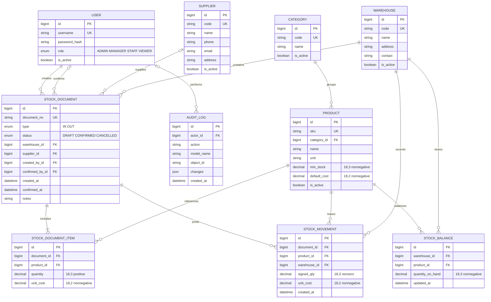

# Smart Warehouse · ERD MVP

- Unique theo cặp: balance `(warehouse, product)`, dòng phiếu `(document, product)`, movement `(document, product)`.
- Mã danh mục, SKU, kho và nhà cung cấp có unique không phân biệt chữ hoa/thường.
- Quan hệ dữ liệu nghiệp vụ dùng `PROTECT`; lưu trữ danh mục bằng `is_active`, không xóa lịch sử.
- Phiếu chỉ thay đổi tồn khi Manager/Admin xác nhận. Một transaction khóa phiếu → kho → sản phẩm theo ID → số dư; khóa kho bảo vệ cả số dư chưa tồn tại.
- `StockMovement` và `AuditLog` chỉ thêm; chỉnh sửa bằng các luồng nghiệp vụ mới. UI/API không cung cấp thao tác ghi đè lịch sử.
- Mỗi SKU có một đơn vị cố định sau giao dịch đầu tiên. Giá trị tồn là ước tính theo `default_cost`, không phải FIFO hoặc định giá kế toán.
- Chuyển kho, kiểm kê, lô, barcode thuộc P2, chưa nằm trong schema MVP.
